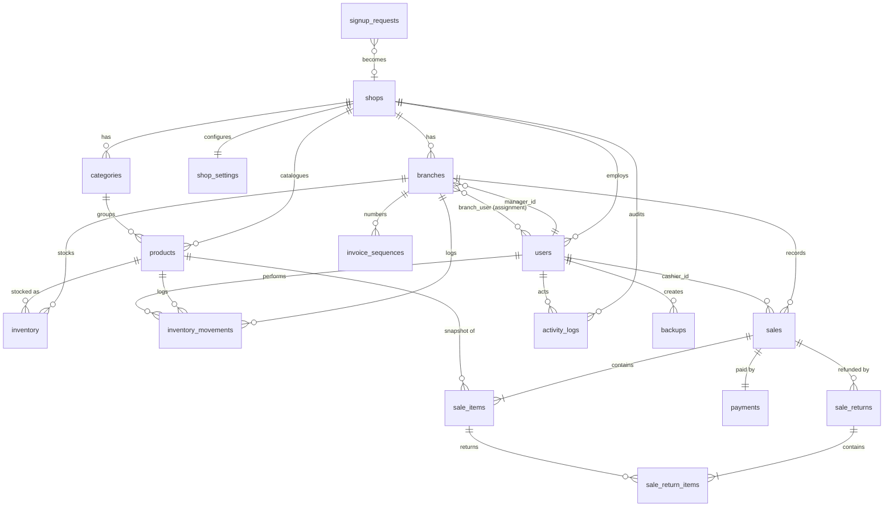

# Database Schema

MySQL 8, database `kirasoft`, all tables **InnoDB**, `utf8mb4_unicode_ci`. Money = `DECIMAL(12,2)`, quantities = `DECIMAL(12,3)`. Created only by migrations in `database/migrations`.

## ER diagram

## Tables

| Table | Purpose | Key columns / constraints |
|---|---|---|
| `shops` | Tenant (one grocery business) | `slug` UNIQUE, `status` active/suspended |
| `users` | All accounts | `email` UNIQUE, `role`, `shop_id` FK (null for Super Admin), `is_active`, soft delete |
| `branches` | Shop outlets | FK shop; UNIQUE (shop_id, code), UNIQUE (shop_id, name); `manager_id` FK users |
| `branch_user` | Branch assignments (membership) | UNIQUE (branch_id, user_id) |
| `shop_settings` | Per-shop config | `shop_id` UNIQUE; currency, logo, receipt header/footer, invoice prefix, tax, default threshold, max discount |
| `categories` | Product groups | UNIQUE (shop_id, name); soft delete = archive |
| `products` | Catalogue | UNIQUE (shop_id, sku); unit, price, cost_price, low_stock_threshold, image; soft delete = archive (never hard-deleted once sold — `sale_items` FK is RESTRICT) |
| `inventory` | Current stock per branch | **UNIQUE (branch_id, product_id)**; quantity DECIMAL(12,3); optional branch threshold |
| `inventory_movements` | Immutable stock ledger | type (opening, stock_in, stock_out, adjustment, sale, return), change/before/after, reason, user, polymorphic reference (sale / return) |
| `invoice_sequences` | Locked per-branch daily counters | UNIQUE (branch_id, scope) |
| `sales` | Invoice header | `invoice_no` UNIQUE, `idempotency_key` UNIQUE, subtotal, discount, tax, total, refunded_total, status, sold_at; indexes (shop,sold_at), (branch,sold_at), (cashier,sold_at) |
| `sale_items` | Invoice lines | snapshots of product_name, sku, unit, unit_price, cost_price; line_total; returned_quantity |
| `payments` | Payment per sale | method (cash), amount, amount_tendered, change_due |
| `sale_returns` | Refund header | `return_no` UNIQUE, refund_amount, reason, user |
| `sale_return_items` | Refund lines | quantity, amount, restocked |
| `activity_logs` | Audit trail | actor, shop, branch, action, polymorphic subject, description, JSON properties (secrets stripped), IP, user agent |
| `signup_requests` | Public shop registration | status pending/approved/rejected, reviewer |
| `backups` | Backup metadata | filename UNIQUE, size, SHA-256 checksum, restore_tested_at |
| `password_reset_tokens`, `sessions` | Laravel auth infrastructure | |
| `cache`, `cache_locks`, `jobs`, `job_batches`, `failed_jobs` | Laravel framework tables | |

## Changes vs. the thesis schema (justification)
- **Multi-tenancy:** `shops` + `shop_id` on every business table, `branch_user` for many-to-many branch assignment.
- **Inventory split:** current quantity (`inventory`, one row per branch+product) and an append-only ledger (`inventory_movements`) so every change is auditable and stock can be reconciled.
- **Snapshots in `sale_items`** keep historical invoices correct after product edits.
- **`payments`** separated from `sales` (future: multiple methods).
- **`invoice_sequences`** gives gap-free, concurrency-safe invoice numbers.
- **`idempotency_key`** prevents duplicate sales on double-click/retry.
- **Returns tables** support controlled partial refunds without editing the original sale.
